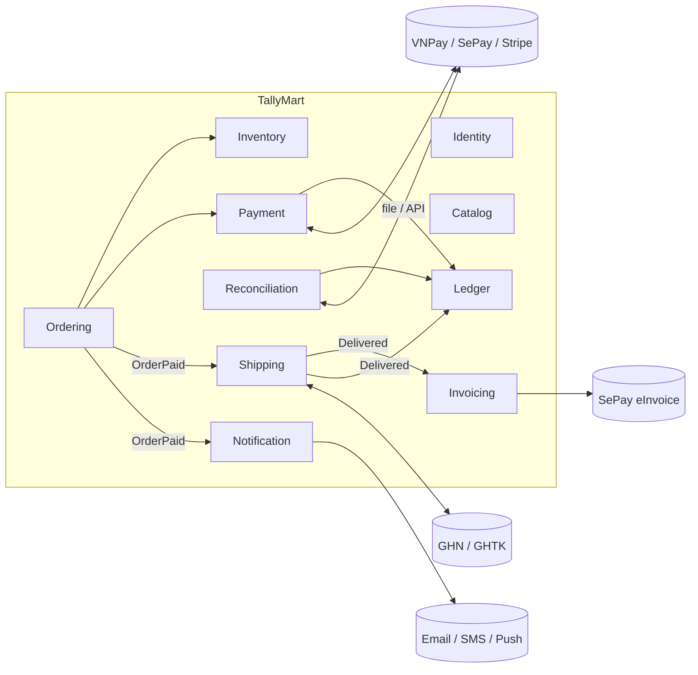

# TallyMart

> **Multi-vendor marketplace where stock and money always add up.**
> The name comes from *tally* (to count so that everything matches): the system's two core invariants are **stock is never oversold** and **the ledger always balances (sum of entries = 0)**.

**A multi-vendor e-commerce marketplace (backend + web):** flash sales, payments through real gateways (sandbox), delivery through real shipping carriers (staging), a double-entry ledger for sellers' money, and reconciliation.

The goal is not the number of features but **being correct under concurrent load and when external systems fail**, proven by tests and measured numbers.

> **Status:** Phase 0, Sprint 0 (high-level design).

---

## The problem

A marketplace where many sellers list products. Buyers place orders and pay via VNPay / QR bank transfer / card; goods are delivered by GHN or GHTK. The marketplace holds the money, deducts its fee, and pays the seller after successful delivery.

The hard parts this project focuses on:

| Situation | Risk if done wrong | How TallyMart handles it |
|---|---|---|
| 1,000 people buy an item with only 10 left (flash sale) | Overselling stock | Locking at the DB level, stock reservations with a TTL, per-user rate limiting |
| A user clicks "Place order" twice on a flaky network | Two orders created, charged twice | `Idempotency-Key` on every write API |
| The payment gateway sends the IPN 10 times, or never sends it | Payment recorded multiple times, or the order stuck in "awaiting payment" | Idempotent IPN handling, actively re-querying the status (`querydr`), saga with compensation |
| The DB write succeeds but publishing the event fails | Order paid but nobody ships it | Transactional Outbox |
| Money in the system does not match the bank | Money lost without anyone noticing | Double-entry ledger (sum of entries always = 0) + nightly reconciliation job |
| The carrier sends status updates out of order or duplicated | A "delivered" order goes back to "in transit" | State machine blocks invalid transitions; deduplication by event key |

---

## Architecture

Modular monolith, split by bounded context. Some contexts will be extracted into separate services in Phase 2, when there is a measurable reason; every extraction has an ADR recording the reason.



| Context | Responsibility |
|---|---|
| **Identity** | Buyers, sellers, admins; JWT authentication (later moving to Keycloak), RBAC authorization |
| **Catalog** | Products, variants, prices; search (Elasticsearch in Phase 2) |
| **Ordering** | Orders and the order state machine; orchestrates the checkout saga |
| **Inventory** | Stock, time-limited stock reservations, flash sales |
| **Payment** | Payment gateway integration, IPN / webhooks, refunds |
| **Ledger** | Append-only double-entry ledger: seller wallets, marketplace fees, withdrawals |
| **Reconciliation** | Reconciles transactions from payment gateways, banks and shipping carriers against internal data |
| **Shipping** | Multi-carrier quotes, creating shipments, receiving delivery-status webhooks |
| **Notification** | Email, SMS, push; tracks delivery status of messages |
| **Invoicing** | Issuing, adjusting and replacing e-invoices |

---

## Tech stack

| Layer | Uses |
|---|---|
| Backend | NestJS (TypeScript) |
| Web | Next.js, Tailwind, shadcn/ui; client generated from OpenAPI |
| Repo | pnpm monorepo: `apps/api`, `apps/web`, `packages/api-client` |
| Data | PostgreSQL, Redis; Elasticsearch (Phase 2) |
| Messaging | RabbitMQ; Kafka + Debezium CDC (Phase 2) |
| Infrastructure | Docker Compose, Nginx, GitHub Actions; Kubernetes (kind/k3d) + Helm (Phase 2) |
| Observability | OpenTelemetry, Prometheus, Grafana, Loki, Tempo (Phase 3) |
| Security | Keycloak, Vault, Linkerd mTLS (Phases 2–4) |
| Testing | Jest, Testcontainers, WireMock, Playwright, k6, Toxiproxy |

## External integrations

Every external service sits behind an interface (port), with a real sandbox implementation and a fake (simulated) implementation. Tests and CI use only the fake implementation, so they never depend on a sandbox.

| Area | Provider (test environment) |
|---|---|
| Payment | VNPay sandbox, SePay Test mode, Stripe test mode |
| Shipping | GHN staging, GHTK staging |
| E-invoice | SePay eInvoice sandbox |
| Notification | Mailtrap / Resend (email), eSMS sandbox (SMS), Firebase Cloud Messaging (push) |
| Identity | Keycloak, Google OAuth, FPT.AI OCR (seller eKYC) |
| Public data | Administrative units after the merger (provinces.open-api.vn v2), VietQR bank list |

---

## Roadmap

The project runs in sprints (each sprint is 2–4 sessions, with a goal, a backlog, a Definition of Done and a version tag). The dates below are estimates.

| Phase | Sprint | Time | Focus |
|---|---|---|---|
| **0. Foundation** | 0–9 | 11/2026 – 03/2027 | High-level design, Identity → Catalog → Ordering → Inventory → Payment (VNPay) → events, with the web UI; REST + idempotency, indexes and query optimization, preventing overselling, caching, load balancer, rate limiter, message queue + DLQ, Docker + CI |
| **1. Money and real integrations** | 10–13 | 03 – 05/2027 | Double-entry ledger, VNPay / SePay / Stripe, Outbox, checkout saga, reconciliation, GHN shipping, e-invoices |
| **2. Event-driven and service extraction** | 14–16 | 06 – 08/2027 | Kafka + CDC, Elasticsearch, CQRS, service extraction, Keycloak, Kubernetes |
| **3. Load and observability** | 17–19 | 09 – 11/2027 | OpenTelemetry, SLOs, load test p99 < 200ms at 2,000 RPS, read replicas, partitioning |
| **4. Operations, security, DR** | 20–22 | 12/2027 – 02/2028 | 2 regions, DR drills, chaos testing, Vault, mTLS, threat model |

Extension tracks: realtime chat, event stream processing, multi-tenancy, news feed, legacy system integration.

---

## Metrics

Every number below is measured by scripts in the repo (`scripts/`, `load-tests/`). Not measured yet = left blank.

| Item | Before | After | How it is measured |
|---|---|---|---|
| Seller's order list (a few million rows), p95 | | | |
| Product detail with cache, p95 | | | |
| Flash sale: 50 concurrent requests, stock of 10 | oversold: ? | oversold: 0 | `scripts/concurrency-test` |
| IPN sent 10 times (duplicates) | | recorded once | |

## Getting started

> **Planned commands, not runnable yet:** the repo has no code. Update this section when Phase 0 is complete.

```bash
cp .env.example .env        # fill in sandbox keys to call real sandboxes; leave empty to use the fakes
docker compose up -d        # Postgres, Redis, RabbitMQ, API, web
pnpm test                   # unit + integration (Testcontainers)
# Web: http://localhost:3000 · API docs (Swagger): http://localhost:8080/docs
```