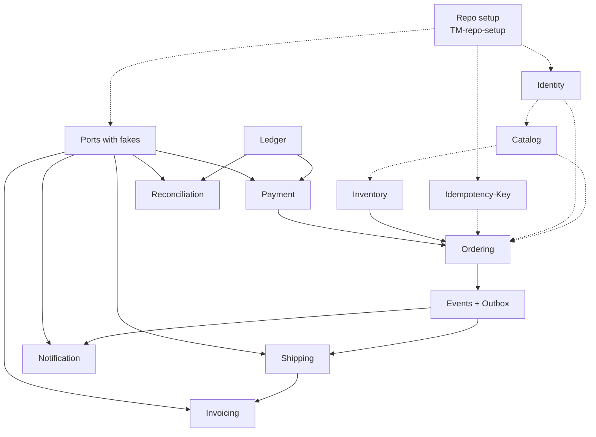

# Project overview

## Goal

TallyMart is a multi-vendor e-commerce marketplace (backend + web). Product description and the hard problems it targets: [README: The problem](../README.md#the-problem).

The goal is stated in the [README](../README.md) intro. It is proven by tests and measured numbers ([R-TEST-02](RULES_AND_CONSTRAINTS.md#r-test-02)).

> OPEN QUESTION Q-32: What are the performance targets per capability? DO NOT assume. → [details](OPEN_QUESTIONS.md#q-32)

## Core invariants

Every design choice MUST protect these two invariants:

| Invariant | Rule |
|---|---|
| Stock is never oversold | [R-INV-01](domain/inventory.md#r-inv-01) |
| The ledger always balances (sum of entries = 0) | [R-LED-01](domain/ledger.md#r-led-01) |

## Users

| User | What they do (from the README) |
|---|---|
| `Buyer` | Places orders and pays through a payment gateway |
| `Seller` | Lists products, receives money after successful delivery |
| `Admin` | Not described in the README beyond the role name |

Definitions: [GLOSSARY](GLOSSARY.md).

> OPEN QUESTION Q-06: Which roles exist, can one user hold several roles, and what can an admin do? DO NOT assume. → [details](OPEN_QUESTIONS.md#q-06)

## Scope

The system is made of 10 contexts. The list and their responsibilities: [README: Architecture](../README.md#architecture). How they connect: [ARCHITECTURE](ARCHITECTURE.md).

## Non-goals

> OPEN QUESTION Q-07: What is explicitly out of scope? DO NOT assume. → [details](OPEN_QUESTIONS.md#q-07)

## Phases

In the README, a "Phase" is a capability group, not a timeline: [GLOSSARY: Phase](GLOSSARY.md#technical-terms).

- Ignore the dates and sprint numbers in the [README Roadmap](../README.md#roadmap).
- Order the work by module dependencies: build a module only after the modules it depends on ([Build order](#build-order)).

## Team and work items

- One developer, working mainly with Claude Code.
- Work items are GitHub issues with IDs `TM-xx`. Naming: [CONVENTIONS](CONVENTIONS.md#work-items).

## Build order

> **Status: proposal for the owner's approval. This is not a decision.**
> OPEN QUESTION Q-09: Is this build order approved, and which module is built first? DO NOT assume. → [details](OPEN_QUESTIONS.md#q-09)
> OPEN QUESTION Q-45: How do epics and the enabling work in steps 0 and 7 (no epic covers them) become the plan? DO NOT assume. → [details](OPEN_QUESTIONS.md#q-45)

The graph below is derived only from the context diagram and tables in the README. The dependency edges themselves are listed in [ARCHITECTURE: Data flow](ARCHITECTURE.md#data-flow).

- Solid arrow `A --> B`: the README backs up that B depends on A, so A is built first.
- Dashed arrow `A -.-> B`: an ordering choice the README does NOT back up. Each one is an open question.

### Steps

| Step | Build | Needs (README backs it up) | Needs (not backed up → open question) |
|---|---|---|---|
| 0 | Repo setup, ports with fakes, Idempotency-Key | none | When to build each piece: [Q-09](OPEN_QUESTIONS.md#q-09), [Q-04](OPEN_QUESTIONS.md#q-04) |
| 1 | Identity | none | Is Identity first? [Q-09](OPEN_QUESTIONS.md#q-09) |
| 2 | Catalog | none | Identity first (sellers own products)? [Q-09](OPEN_QUESTIONS.md#q-09) |
| 3 | Inventory | none | Catalog first (stock belongs to a product or variant)? [Q-09](OPEN_QUESTIONS.md#q-09), [Q-13](OPEN_QUESTIONS.md#q-13) |
| 4 | Ledger | none | Build before Payment, or build Payment first? [Q-09](OPEN_QUESTIONS.md#q-09) |
| 5 | Payment | Ledger, ports with fakes | none |
| 6 | Ordering | Inventory, Payment | Catalog, Identity, Idempotency-Key. Or build Ordering early against fakes? [Q-09](OPEN_QUESTIONS.md#q-09). Shipping quote at checkout (would need Shipping first)? [Q-43](OPEN_QUESTIONS.md#q-43) |
| 7 | Events + Outbox | Ordering (publishes `OrderPaid`) | Outbox at the same time or later? [Q-26](OPEN_QUESTIONS.md#q-26) |
| 8 | Shipping, Notification | `OrderPaid` event, ports with fakes | none |
| 9 | Invoicing | `Delivered` event from Shipping, ports with fakes | none |
| 10 | Reconciliation | Ledger, gateway files or API (ports with fakes) | Must Payment exist first? [Q-09](OPEN_QUESTIONS.md#q-09) |

### Edge cases

- Step 0 pieces are cross-cutting. Each one is built no later than the first module that needs it. Which module needs it first is part of [Q-09](OPEN_QUESTIONS.md#q-09).
- Shipping and Notification (both step 8) MAY be built in either order, because neither depends on the other in the README.
- Ledger consumes `Delivered` from Shipping (README). Shipping does not wait for Ledger. Ledger is built at step 4, but its handling of `Delivered` ([R-LED-03](domain/ledger.md#r-led-03)) can be finished only once Shipping exists (step 8).
