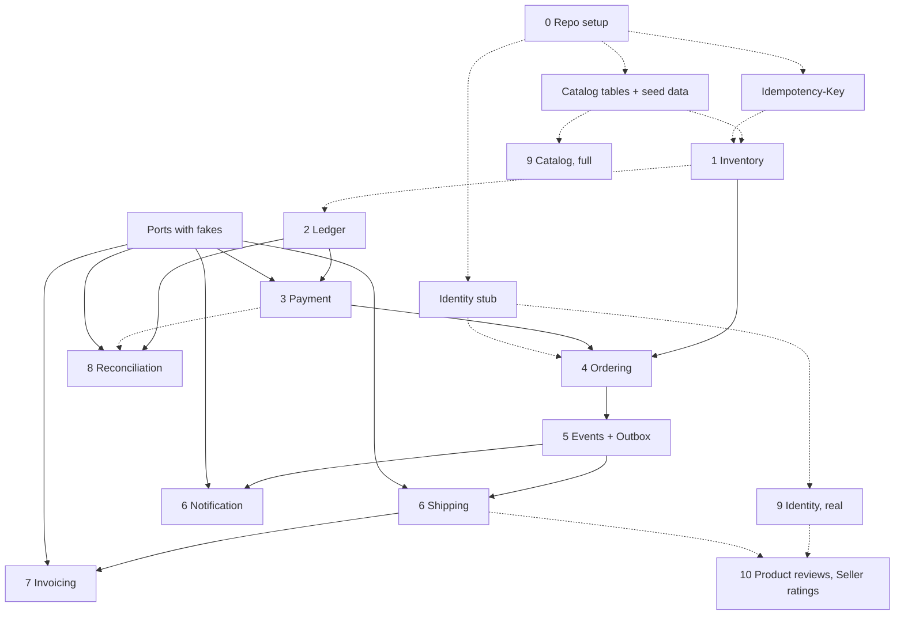

# Project overview

## Goal

TallyMart is a multi-vendor e-commerce marketplace (backend + web). Product description and the hard problems it targets: [README: The problem](../README.md#the-problem).

The goal is stated in the [README](../README.md) intro. It is proven by tests and measured numbers ([R-TEST-02](RULES_AND_CONSTRAINTS.md#r-test-02)).

Performance targets: build a baseline script per capability first, then set targets; correctness targets apply from the first test ([Q-32](OPEN_QUESTIONS.md#q-32) decision).

## Core invariants

Every design choice MUST protect these two invariants:

| Invariant | Rule |
|---|---|
| Stock is never oversold | [R-INV-01](domain/inventory.md#r-inv-01) |
| The ledger always balances (sum of entries = 0) | [R-LED-01](domain/ledger.md#r-led-01) |

## Users

| User | What they do (from the README) |
|---|---|
| `Buyer` | Places orders and pays through a payment gateway |
| `Seller` | Lists products, receives money after successful delivery |
| `Admin` | Not described in the README beyond the role name |

Definitions: [GLOSSARY](GLOSSARY.md).

One user MAY hold several roles ([R-IDN-03](domain/identity.md#r-idn-03)). Admin actions stay in the owning context, with one Audit trail ([R-ARCH-04](RULES_AND_CONSTRAINTS.md#r-arch-04)).

## Scope

The system is made of 10 contexts. The list and their responsibilities: [README: Architecture](../README.md#architecture). How they connect: [ARCHITECTURE](ARCHITECTURE.md).

## Non-goals

TallyMart is a learning project: it has no demo and no users to ship to. The core is the 10 contexts and the two invariants. Source: [Q-07](OPEN_QUESTIONS.md#q-07) decision.

- A production launch with real money MUST NOT be built. Tests and CI use sandboxes and fakes only ([R-INT-02](RULES_AND_CONSTRAINTS.md#r-int-02)).
- Anything in [Learning extensions](#learning-extensions) MUST NOT be built until the owner moves it into scope. When an AI session is asked for one, it names this section and asks.

### Learning extensions

Topics outside the core that the owner MAY pick up after the core, to learn more. Moving one into scope is an owner decision: record it in [OPEN_QUESTIONS](OPEN_QUESTIONS.md) and the linked epic.

**With room in the model now.** Adding these later MUST NOT require changing existing Ledger entries or Stock data.

| Extension | Room left now | Source |
|---|---|---|
| Several Sellers in one checkout | None: adding it later means a parent record over Orders and re-pointing Payment to it (accepted cost) | [Q-05](OPEN_QUESTIONS.md#q-05), [R-ORD-04](domain/ordering.md#r-ord-04) |
| COD | Ledger accounts can hold money owed by a Carrier | [Q-35](OPEN_QUESTIONS.md#q-35), [R-LED-04](domain/ledger.md#r-led-04), [EP-22](product/EPICS.md#ep-22) |
| Vouchers | After the Ledger is proven | [Q-36](OPEN_QUESTIONS.md#q-36), [EP-29](product/EPICS.md#ep-29) |
| Returns, Disputes, Wallet hold | Successful delivery already waits a return window ([R-LED-03](domain/ledger.md#r-led-03)) | [Q-37](OPEN_QUESTIONS.md#q-37), [Q-34](OPEN_QUESTIONS.md#q-34), [EP-17](product/EPICS.md#ep-17), [EP-18](product/EPICS.md#ep-18) |
| Partial Refunds, Refunds after the Seller is paid | Refund goes through Payment and Ledger entries ([R-PAY-04](domain/payment.md#r-pay-04)) | [Q-23](OPEN_QUESTIONS.md#q-23) |
| Seller tax withholding | Ledger accounts are data ([R-LED-04](domain/ledger.md#r-led-04)) | [Q-39](OPEN_QUESTIONS.md#q-39), [EP-23](product/EPICS.md#ep-23) |
| SePay and Stripe | The Payment gateway port is shaped for all three ([R-PAY-03](domain/payment.md#r-pay-03)) | [Q-21](OPEN_QUESTIONS.md#q-21) |
| Carrier Shipping quotes at checkout | The Shipping fee is stored on the Order ([R-ORD-06](domain/ordering.md#r-ord-06)) | [Q-43](OPEN_QUESTIONS.md#q-43) |

**No room needed.** These are separate from money and stock.

| Extension | Source |
|---|---|
| Native mobile apps | [Q-07](OPEN_QUESTIONS.md#q-07) |
| Seller storefront design | [Q-07](OPEN_QUESTIONS.md#q-07) |
| Recommendation and search ranking | [Q-07](OPEN_QUESTIONS.md#q-07) |
| Buyer–Seller chat, livestream selling | [Q-36](OPEN_QUESTIONS.md#q-36), [EP-31](product/EPICS.md#ep-31) |
| Seller subscriptions, sponsored placement | [Q-36](OPEN_QUESTIONS.md#q-36), [EP-30](product/EPICS.md#ep-30) |
| More than one currency (a `currency` column exists: [CONVENTIONS: Money](CONVENTIONS.md#money)) | [Q-07](OPEN_QUESTIONS.md#q-07), [Q-12](OPEN_QUESTIONS.md#q-12) |
| A polished Admin UI, i18n | [Q-07](OPEN_QUESTIONS.md#q-07) |
| A real eKYC provider | [Q-07](OPEN_QUESTIONS.md#q-07), [Q-11](OPEN_QUESTIONS.md#q-11) |
| Multi-channel stock sync | [Q-07](OPEN_QUESTIONS.md#q-07), [Q-40](OPEN_QUESTIONS.md#q-40), [EP-28](product/EPICS.md#ep-28) |
| SMS and push notifications | [Q-29](OPEN_QUESTIONS.md#q-29) |
| Fraud signals and Seller penalties | [Q-41](OPEN_QUESTIONS.md#q-41), [EP-26](product/EPICS.md#ep-26) |
| Reconciliation with Carriers and banks | none |
| Seller and finance reports beyond the Seller statement | [Q-42](OPEN_QUESTIONS.md#q-42) |

## Phases

In the README, a "Phase" is a capability group, not a timeline: [GLOSSARY: Phase](GLOSSARY.md#technical-terms).

- Ignore the dates and sprint numbers in the [README Roadmap](../README.md#roadmap).
- Order the work by module dependencies: build a module only after the modules it depends on ([Build order](#build-order)).

## Team and work items

- One developer, working mainly with Claude Code.
- Work items are GitHub issues with IDs `TM-xx`. Naming: [CONVENTIONS](CONVENTIONS.md#work-items).

## Build order

Decided by the owner on 2026-11-21 ([Q-09](OPEN_QUESTIONS.md#q-09)). The Build order is the plan: work follows these steps, and epics are mapped onto them ([Q-45](OPEN_QUESTIONS.md#q-45)).

Inventory comes first for learning value: the first module works on concurrency ([R-INV-01](domain/inventory.md#r-inv-01)) instead of auth setup and CRUD. The Ledger MUST exist before Payment, so no money is recorded outside the double-entry Ledger ([R-LED-01](domain/ledger.md#r-led-01)).

- Solid arrow `A --> B`: the README backs up that B depends on A. The edges are listed in [ARCHITECTURE: Data flow](ARCHITECTURE.md#data-flow).
- Dashed arrow `A -.-> B`: an ordering the owner chose in Q-09; the README does not require it.

### Steps

| Step | Build | Needs (README backs it up) | Needs (owner's choice, Q-09) | Still open |
|---|---|---|---|---|
| 0 | Repo setup; `Idempotency-Key`; Catalog tables with seed data; Identity stub | none | none | none |
| 1 | Inventory | none | Catalog tables ([R-CAT-01](domain/catalog.md#r-cat-01)), `Idempotency-Key` | none |
| 2 | Ledger | none | after Inventory | none |
| 3 | Payment; ports with fakes | Ledger, ports with fakes | none | none |
| 4 | Ordering | Inventory, Payment | Identity stub | Order state names and saga steps: Ordering spec |
| 5 | Events + Outbox | Ordering (publishes `OrderPaid`) | none | none |
| 6 | Shipping, Notification | `OrderPaid` event, ports with fakes | none | none |
| 7 | Invoicing | `Delivered` event from Shipping, ports with fakes | none | none |
| 8 | Reconciliation | Ledger, gateway files or API (ports with fakes) | after Payment | none |
| 9 | Identity (real, replaces the stub); full Catalog (Seller-facing API) | none | Identity stub, Catalog tables | Ownership checks: [Q-51](OPEN_QUESTIONS.md#q-51) |
| 10 | Product reviews and Seller ratings | none | Identity (real), `Delivered` from Shipping | none |

### Edge cases

- Step 0 pieces are cross-cutting. Each one is built no later than the first module that needs it: `Idempotency-Key` with the first write API ([R-API-01](RULES_AND_CONSTRAINTS.md#r-api-01)), ports with fakes with Payment, the first external system.
- Catalog tables at step 0 MUST be the real schema ([R-CAT-01](domain/catalog.md#r-cat-01)), not throwaway tables. Only the Seller-facing API waits for step 9.
- The Identity stub reads the current user from a request header. It MUST sit behind the same "current user" interface the real Identity will implement, so step 9 changes no controller. Until step 9 there are no ownership checks; the stub never leaves local and test environments.
- Shipping and Notification (both step 6) MAY be built in either order, because neither depends on the other in the README.
- Ledger consumes `Delivered` from Shipping (README). Ledger is built at step 2, but its handling of `Delivered` ([R-LED-03](domain/ledger.md#r-led-03)) can be finished only once Shipping exists (step 6).
