# System tour

This file is a derived view of the sources listed in `derived_from`. It adds nothing new. If it disagrees with a source, the source wins. When a source changes, regenerate this file, then `system-tour.html`.

## 0. How to read this tour

Every feature, step and box shows its status.

| Status | Meaning | In text | In flowcharts | In sequence diagrams |
|---|---|---|---|---|
| Core | The README states it | "Core" | solid box, solid arrow (class `core`) | solid arrow |
| Proposed | Only an epic states it, and the epic's Decision is `_pending_` | "Proposed (EP-xx)" | dashed box, dashed arrow (class `proposed`) | dotted arrow, label names the EP-xx |
| Accepted | An epic whose Decision is `accepted` or `changed` | "Accepted (EP-xx)" | solid thick box + "EP-xx" (class `accepted`) | solid arrow + "EP-xx" |
| Undecided | An open question blocks it | ❓Q-xx | ❓Q-xx on the exact box or arrow; amber box (class `decision`) when the whole step is undecided | ❓Q-xx in the label or a note on the exact step |

- **No epic is Accepted yet.** All 31 epics in [EPICS](../product/EPICS.md#summary) have Decision `_pending_`.
- An epic whose Scope is "README" describes a Core capability. Any detail that such an epic adds and the README does not state is shown as Proposed.
- Under each diagram, "❓ in this diagram" links every Q-ID it shows to [OPEN_QUESTIONS](../OPEN_QUESTIONS.md). A recommendation in OPEN_QUESTIONS is advice, not a decision.
- A rule ID such as `R-INV-01` links to the rule. Diagrams cite rule IDs in brackets.

Sources: [EPICS: How to use this file](../product/EPICS.md#how-to-use-this-file), [OPEN_QUESTIONS](../OPEN_QUESTIONS.md), [docs/README: Open questions](../README.md#open-questions)

## 1. The system in 5 minutes

**What it is.** TallyMart is an online marketplace with many sellers. A **Seller** (a user who lists products and receives money after successful delivery) puts **Products** (items for sale) on the marketplace. A **Buyer** (a user who places orders) places an **Order** (a request to buy Products) and pays online. An **Admin** (a user who runs the marketplace) looks after the marketplace. What an Admin may do is not decided yet ([Q-06](../OPEN_QUESTIONS.md#q-06)).

**How money moves.** The Buyer pays online by VNPay, QR bank transfer or card, through a **Payment gateway** (an outside company that takes the Buyer's money). The marketplace holds the money. It deducts its **Marketplace fee** (the amount the marketplace keeps). It pays the Seller only after **successful delivery** (the point after which a Seller may be paid). The Seller then takes the money out with a **Withdrawal** (moving money out of the Seller's wallet).

**How goods move.** A **Carrier** (an outside shipping company: GHN or GHTK) delivers the goods to the Buyer.

**Why it is hard.** The goal is not many features. The goal is to stay correct when many people act at the same moment, and when outside systems fail. Tests and measured numbers must prove it. Today the project is in high-level design, and the repo has no code.

**The two core invariants** (an **invariant** is a condition that must be true at all times):

1. **Stock is never oversold** ([R-INV-01](../domain/inventory.md#r-inv-01)). **Stock** is how many units can be sold. To **Oversell** is to sell more units than the Stock allows. *Everyday example:* a Seller has 10 umbrellas and 1,000 people try to buy one at the same moment in a **flash sale** (a sale where many Buyers compete for little Stock). At most 10 people may get one. If an 11th person pays, the marketplace has taken money for an umbrella that does not exist.
2. **The ledger always balances: the sum of all entries is 0** ([R-LED-01](../domain/ledger.md#r-led-01)). The **Ledger** is the record of all money the marketplace holds. Every movement is written as **Ledger entries** (lines in the Ledger), at least twice: once where the money leaves, once where it arrives. Each line belongs to a **Ledger account** (a named group of entries, such as one Seller's wallet). *Everyday example:* you move 100 from your left pocket to your right pocket. You write "-100 left pocket" and "+100 right pocket". The two lines add up to 0. If you wrote only "+100", money would appear from nowhere, and nobody could say where it came from. Without this rule, money in the system could stop matching the bank, and money could be lost without anyone noticing.

Sources: [README](../../README.md), [README: The problem](../../README.md#the-problem), [PROJECT_OVERVIEW: Users](../PROJECT_OVERVIEW.md#users), [GLOSSARY](../GLOSSARY.md), [inventory.md](../domain/inventory.md), [ledger.md](../domain/ledger.md)

## 2. Big picture

TallyMart is split into 10 **contexts** (a context is one business area with its own rules). They all live in one application (a modular monolith).

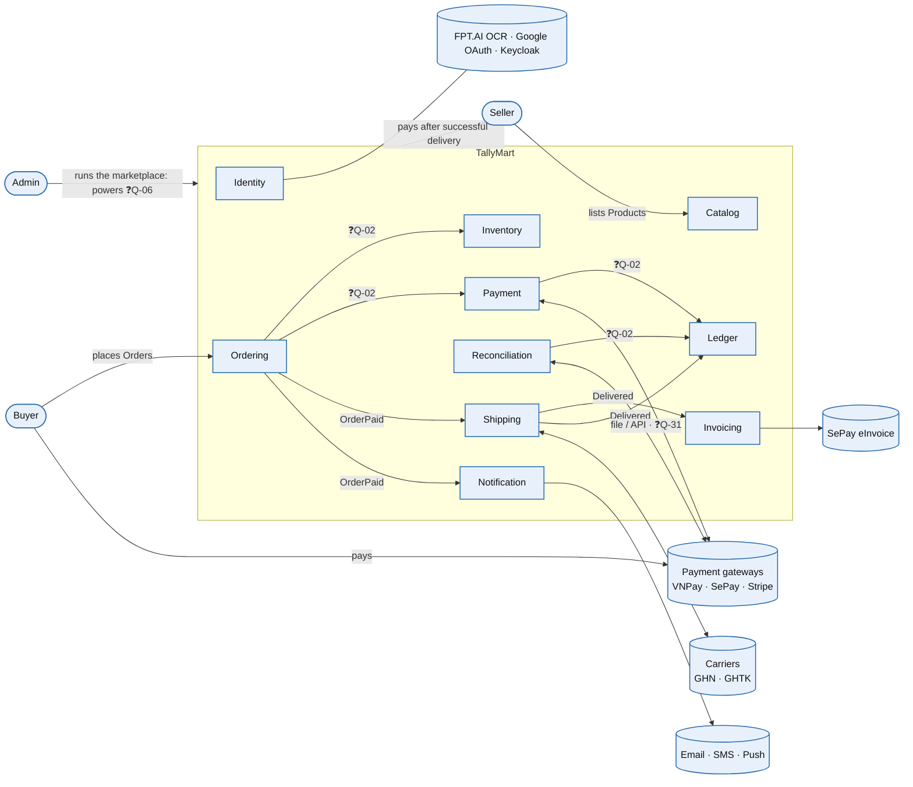

The arrows between contexts are the ones the README draws. `OrderPaid` and `Delivered` are **Events** (facts that already happened, published for other contexts). For the four arrows with no label, it is not decided whether they are direct calls or Events. Identity and Catalog have no arrows between contexts in the README. The Identity providers are in the README integrations table but not in its diagram. The README also names public data (administrative units, VietQR bank list), but no context for it.

❓ in this diagram: [Q-02](../OPEN_QUESTIONS.md#q-02) · [Q-06](../OPEN_QUESTIONS.md#q-06) · [Q-31](../OPEN_QUESTIONS.md#q-31)

| Context | What it does |
|---|---|
| Identity | Buyers, Sellers, Admins; sign-in (JWT, later Keycloak); access by **Role** (a named set of permissions, RBAC) |
| Catalog | Products, **Variants** (sellable versions of a Product), **Prices** (what a Buyer pays for one unit); search |
| Ordering | Orders and the **Order state machine** (the allowed Order states and moves); runs the **Checkout saga** (the multi-step checkout) |
| Inventory | Stock, **Stock reservations** (Stock set aside for a limited time so nobody else can buy it), flash sales |
| Payment | Payment gateways, **IPNs** (calls from a gateway that report a payment result) and **Webhooks** (HTTP calls from an outside system), **Refunds** (money returned to a Buyer) |
| Ledger | Append-only double-entry Ledger: **Seller wallets** (money the marketplace holds for one Seller), Marketplace fees, Withdrawals |
| Reconciliation | **Reconciliation** (comparing outside records with internal data): records from Payment gateways, banks and Carriers ❓[Q-31](../OPEN_QUESTIONS.md#q-31) |
| Shipping | **Shipping quotes** (a Carrier's price for a Shipment) from several Carriers, creating **Shipments** (deliveries of goods by a Carrier), Carrier status Webhooks |
| Notification | **Notifications** (messages to a user by email, SMS or push); tracks whether each one was delivered |
| Invoicing | Issuing, adjusting and replacing **E-invoices** (electronic invoices) |

Every outside system sits behind a **Port** (an interface) with a **Sandbox** implementation (the provider's test environment) and a **Fake implementation** (a simulation with no network call). Tests use only the fake ([R-INT-01](../RULES_AND_CONSTRAINTS.md#r-int-01), [R-INT-02](../RULES_AND_CONSTRAINTS.md#r-int-02)).

Sources: [README: Architecture](../../README.md#architecture), [README: External integrations](../../README.md#external-integrations), [ARCHITECTURE: Data flow](../ARCHITECTURE.md#data-flow), [ARCHITECTURE: External systems](../ARCHITECTURE.md#external-systems), [RULES_AND_CONSTRAINTS](../RULES_AND_CONSTRAINTS.md)

## 3. Role guides

### 3.1 Buyer

**What TallyMart does for you**

- Stock is never oversold, even in a flash sale ([R-INV-01](../domain/inventory.md#r-inv-01)).
- A double click or a retry on a weak network never creates a second Order or charges you twice.
- You pay online by VNPay, QR bank transfer or card. If the payment result gets lost, TallyMart asks the Payment gateway itself, so your Order does not stay stuck in "awaiting payment".
- A Carrier delivers your goods. After delivery an E-invoice is issued; who receives it is not decided ([Q-30](../OPEN_QUESTIONS.md#q-30)).

**Features**

| Feature | Epic | Status | ❓ |
|---|---|---|---|
| Sign up and sign in | [EP-01](../product/EPICS.md#ep-01) | Core | [Q-06](../OPEN_QUESTIONS.md#q-06) |
| Browse and search Products, Variants and Prices | [EP-03](../product/EPICS.md#ep-03) | Core | [Q-13](../OPEN_QUESTIONS.md#q-13), [Q-12](../OPEN_QUESTIONS.md#q-12) |
| Stock that is never oversold; a Stock reservation during checkout | [EP-04](../product/EPICS.md#ep-04) | Core | [Q-14](../OPEN_QUESTIONS.md#q-14) |
| Honest "sold out" | [EP-04](../product/EPICS.md#ep-04) | Proposed (EP-04) | |
| Flash sales with a per-user rate limit | [EP-05](../product/EPICS.md#ep-05) | Core | [Q-17](../OPEN_QUESTIONS.md#q-17), [Q-16](../OPEN_QUESTIONS.md#q-16) |
| Flash sale countdown and protection against bots | [EP-05](../product/EPICS.md#ep-05) | Proposed (EP-05) | [Q-17](../OPEN_QUESTIONS.md#q-17) |
| Place an Order; a repeat has one effect | [EP-06](../product/EPICS.md#ep-06) | Core | [Q-05](../OPEN_QUESTIONS.md#q-05), [Q-43](../OPEN_QUESTIONS.md#q-43) |
| Pay by VNPay, QR bank transfer or card | [EP-07](../product/EPICS.md#ep-07) | Core | [Q-21](../OPEN_QUESTIONS.md#q-21), [Q-22](../OPEN_QUESTIONS.md#q-22) |
| **COD** (cash on delivery: the Carrier collects the money from the Buyer and sends it to the marketplace later) | [EP-22](../product/EPICS.md#ep-22) | Proposed (EP-22) | [Q-35](../OPEN_QUESTIONS.md#q-35) |
| Refund | [EP-14](../product/EPICS.md#ep-14) | Core | [Q-23](../OPEN_QUESTIONS.md#q-23) |
| **Cancellation** (ending an Order before it ships) | [EP-14](../product/EPICS.md#ep-14) | Proposed (EP-14) | [Q-25](../OPEN_QUESTIONS.md#q-25), [Q-38](../OPEN_QUESTIONS.md#q-38) |
| A Carrier delivers the Shipment | [EP-10](../product/EPICS.md#ep-10) | Core | [Q-28](../OPEN_QUESTIONS.md#q-28) |
| Live tracking of the Shipment | [EP-10](../product/EPICS.md#ep-10) | Proposed (EP-10) | |
| A Notification to the Buyer when the Order is paid (`OrderPaid` → Notification is Core) | [EP-11](../product/EPICS.md#ep-11) | Undecided | [Q-29](../OPEN_QUESTIONS.md#q-29) |
| Notifications at shipped, delivered, Refund done | [EP-11](../product/EPICS.md#ep-11) | Proposed (EP-11) | [Q-29](../OPEN_QUESTIONS.md#q-29) |
| An E-invoice for the Buyer (issuing E-invoices after delivery is Core) | [EP-12](../product/EPICS.md#ep-12) | Undecided | [Q-30](../OPEN_QUESTIONS.md#q-30) |
| **Return** (sending goods back after delivery) and Refund | [EP-17](../product/EPICS.md#ep-17) | Proposed (EP-17) | [Q-37](../OPEN_QUESTIONS.md#q-37), [Q-34](../OPEN_QUESTIONS.md#q-34) |
| **Dispute** (an Admin decides when Buyer and Seller disagree) | [EP-18](../product/EPICS.md#ep-18) | Proposed (EP-18) | [Q-37](../OPEN_QUESTIONS.md#q-37), [Q-34](../OPEN_QUESTIONS.md#q-34), [Q-20](../OPEN_QUESTIONS.md#q-20) |
| Personal data protection | [EP-24](../product/EPICS.md#ep-24) | Proposed (EP-24) | [Q-39](../OPEN_QUESTIONS.md#q-39) |
| **Product reviews** (ratings and comments from Buyers whose Order was delivered) and **Seller ratings** (a score for a Seller) | [EP-25](../product/EPICS.md#ep-25) | Proposed (EP-25) | [Q-36](../OPEN_QUESTIONS.md#q-36) |
| **Vouchers** (offers that lower what the Buyer pays) | [EP-29](../product/EPICS.md#ep-29) | Proposed (EP-29) | [Q-36](../OPEN_QUESTIONS.md#q-36) |
| Chat with Sellers | [EP-31](../product/EPICS.md#ep-31) | Proposed (EP-31, priority Won't this time) | [Q-36](../OPEN_QUESTIONS.md#q-36) |

**Journey**

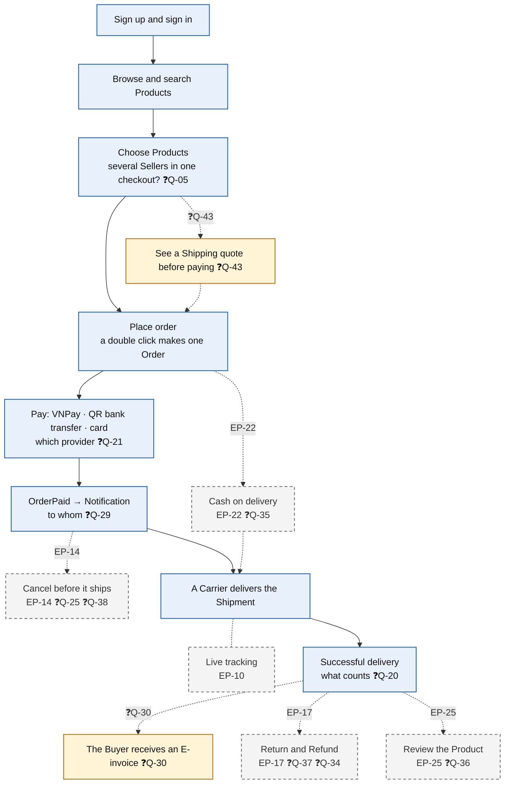

The solid path is the Core journey from sign-up to successful delivery. Dashed boxes are proposed epics. Amber boxes are steps that may or may not exist until the question is answered.

❓ in this diagram: [Q-05](../OPEN_QUESTIONS.md#q-05) · [Q-20](../OPEN_QUESTIONS.md#q-20) · [Q-21](../OPEN_QUESTIONS.md#q-21) · [Q-25](../OPEN_QUESTIONS.md#q-25) · [Q-29](../OPEN_QUESTIONS.md#q-29) · [Q-30](../OPEN_QUESTIONS.md#q-30) · [Q-34](../OPEN_QUESTIONS.md#q-34) · [Q-35](../OPEN_QUESTIONS.md#q-35) · [Q-36](../OPEN_QUESTIONS.md#q-36) · [Q-37](../OPEN_QUESTIONS.md#q-37) · [Q-38](../OPEN_QUESTIONS.md#q-38) · [Q-43](../OPEN_QUESTIONS.md#q-43)

**Decisions that affect Buyers:** [Q-05](../OPEN_QUESTIONS.md#q-05) (one checkout, several Sellers?) · [Q-14](../OPEN_QUESTIONS.md#q-14) (how long Stock is reserved) · [Q-20](../OPEN_QUESTIONS.md#q-20) (successful delivery; the **return window**, a period after delivery in which a Buyer may start a Return) · [Q-21](../OPEN_QUESTIONS.md#q-21) (which provider serves each **Payment method**, the way a Buyer pays) · [Q-25](../OPEN_QUESTIONS.md#q-25) (checkout and Cancellation steps) · [Q-29](../OPEN_QUESTIONS.md#q-29) (which Notifications) · [Q-30](../OPEN_QUESTIONS.md#q-30) (E-invoice) · [Q-34](../OPEN_QUESTIONS.md#q-34) (who decides a Refund) · [Q-35](../OPEN_QUESTIONS.md#q-35) (COD) · [Q-36](../OPEN_QUESTIONS.md#q-36) (reviews, Vouchers, chat) · [Q-37](../OPEN_QUESTIONS.md#q-37) (Returns, Disputes) · [Q-38](../OPEN_QUESTIONS.md#q-38) (who may cancel) · [Q-39](../OPEN_QUESTIONS.md#q-39) (personal data) · [Q-43](../OPEN_QUESTIONS.md#q-43) (Shipping quote before paying)

Sources: [README: The problem](../../README.md#the-problem), [EPICS](../product/EPICS.md), [GLOSSARY](../GLOSSARY.md), [ordering.md](../domain/ordering.md), [payment.md](../domain/payment.md), [inventory.md](../domain/inventory.md)

### 3.2 Seller

**What TallyMart does for you**

- You list your Products, Variants and Prices, and sell to Buyers on one marketplace.
- Your Stock is never oversold, even when a flash sale brings many Buyers at once.
- The marketplace holds the Buyer's money and pays you after successful delivery. Every money movement is recorded as Ledger entries that always add up.
- You take your money out with a Withdrawal.

**Features**

| Feature | Epic | Status | ❓ |
|---|---|---|---|
| Seller account | [EP-01](../product/EPICS.md#ep-01) | Core | [Q-06](../OPEN_QUESTIONS.md#q-06) |
| Seller team members with limited permissions | [EP-01](../product/EPICS.md#ep-01) | Proposed (EP-01) | [Q-06](../OPEN_QUESTIONS.md#q-06) |
| **eKYC** (electronic identity check, by FPT.AI OCR) | [EP-02](../product/EPICS.md#ep-02) | Core | [Q-11](../OPEN_QUESTIONS.md#q-11) |
| Seller application, bank account registration, Admin review | [EP-02](../product/EPICS.md#ep-02) | Proposed (EP-02) | [Q-11](../OPEN_QUESTIONS.md#q-11) |
| Create Products, Variants and Prices | [EP-03](../product/EPICS.md#ep-03) | Core | [Q-13](../OPEN_QUESTIONS.md#q-13), [Q-12](../OPEN_QUESTIONS.md#q-12) |
| Stock, never oversold | [EP-04](../product/EPICS.md#ep-04) | Core | [Q-13](../OPEN_QUESTIONS.md#q-13), [Q-15](../OPEN_QUESTIONS.md#q-15) |
| Flash sales | [EP-05](../product/EPICS.md#ep-05) | Core | [Q-17](../OPEN_QUESTIONS.md#q-17) |
| Bulk product import from a file | [EP-27](../product/EPICS.md#ep-27) | Proposed (EP-27) | [Q-40](../OPEN_QUESTIONS.md#q-40) |
| Multi-channel stock sync | [EP-28](../product/EPICS.md#ep-28) | Proposed (EP-28) | [Q-40](../OPEN_QUESTIONS.md#q-40) |
| Confirm, pack, cancel in bulk; print **Shipping labels** (the printed document a Seller sticks on the goods so the Carrier can collect them) | [EP-15](../product/EPICS.md#ep-15) | Proposed (EP-15) | [Q-38](../OPEN_QUESTIONS.md#q-38) |
| Shipping quotes, Shipments, Carrier status updates | [EP-10](../product/EPICS.md#ep-10) | Core | [Q-28](../OPEN_QUESTIONS.md#q-28) |
| Failed delivery and **return to sender** (goods come back after a failed delivery) | [EP-16](../product/EPICS.md#ep-16) | Proposed (EP-16) | [Q-37](../OPEN_QUESTIONS.md#q-37) |
| Seller wallet; Marketplace fee deducted | [EP-08](../product/EPICS.md#ep-08) | Core | [Q-18](../OPEN_QUESTIONS.md#q-18), [Q-19](../OPEN_QUESTIONS.md#q-19) |
| Withdrawal | [EP-09](../product/EPICS.md#ep-09) | Core | [Q-20](../OPEN_QUESTIONS.md#q-20), [Q-47](../OPEN_QUESTIONS.md#q-47) |
| Withdrawal to a verified bank account; reversal of a failed bank transfer | [EP-09](../product/EPICS.md#ep-09) | Proposed (EP-09) | [Q-47](../OPEN_QUESTIONS.md#q-47), [Q-11](../OPEN_QUESTIONS.md#q-11) |
| Notifications at new Order, Withdrawal done | [EP-11](../product/EPICS.md#ep-11) | Proposed (EP-11) | [Q-29](../OPEN_QUESTIONS.md#q-29) |
| **Seller statement** (every Ledger entry per Order) and reports | [EP-20](../product/EPICS.md#ep-20) | Proposed (EP-20) | [Q-42](../OPEN_QUESTIONS.md#q-42) |
| **Seller tax withholding** (tax the marketplace deducts from a Seller's money and declares for the Seller) | [EP-23](../product/EPICS.md#ep-23) | Proposed (EP-23) | [Q-39](../OPEN_QUESTIONS.md#q-39) |
| Seller-funded Vouchers | [EP-29](../product/EPICS.md#ep-29) | Proposed (EP-29) | [Q-36](../OPEN_QUESTIONS.md#q-36) |
| Paid Seller tier and sponsored placement | [EP-30](../product/EPICS.md#ep-30) | Proposed (EP-30) | [Q-36](../OPEN_QUESTIONS.md#q-36) |

**Journey**

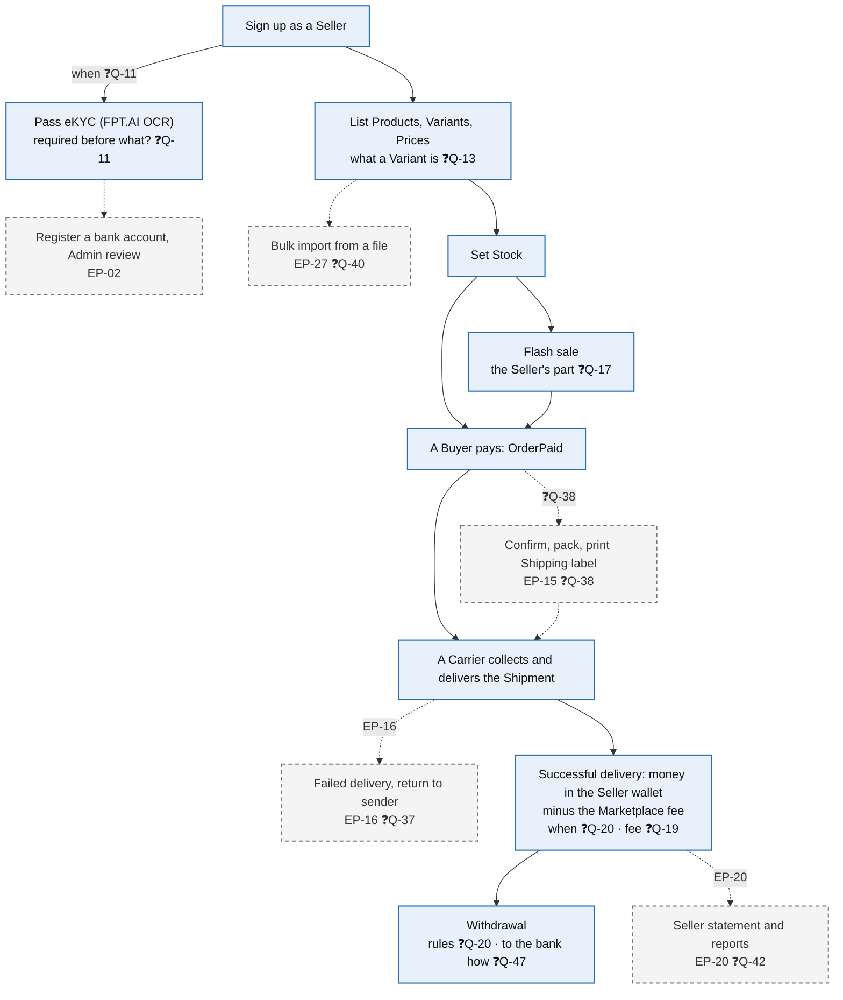

The solid path is Core: the README goes from `OrderPaid` straight to Shipping. Whether the Seller has a handling step in between is open. When eKYC is required, when the Seller's money becomes available, and when the fee is taken, are not decided.

❓ in this diagram: [Q-11](../OPEN_QUESTIONS.md#q-11) · [Q-13](../OPEN_QUESTIONS.md#q-13) · [Q-17](../OPEN_QUESTIONS.md#q-17) · [Q-19](../OPEN_QUESTIONS.md#q-19) · [Q-20](../OPEN_QUESTIONS.md#q-20) · [Q-37](../OPEN_QUESTIONS.md#q-37) · [Q-38](../OPEN_QUESTIONS.md#q-38) · [Q-40](../OPEN_QUESTIONS.md#q-40) · [Q-42](../OPEN_QUESTIONS.md#q-42) · [Q-47](../OPEN_QUESTIONS.md#q-47)

**Decisions that affect Sellers:** [Q-11](../OPEN_QUESTIONS.md#q-11) (when eKYC is required) · [Q-13](../OPEN_QUESTIONS.md#q-13) (Variants, where Stock lives) · [Q-17](../OPEN_QUESTIONS.md#q-17) (flash sale rules) · [Q-18](../OPEN_QUESTIONS.md#q-18) (Ledger accounts) · [Q-19](../OPEN_QUESTIONS.md#q-19) (fee rate and timing) · [Q-20](../OPEN_QUESTIONS.md#q-20) (when money becomes available) · [Q-36](../OPEN_QUESTIONS.md#q-36) (Vouchers, paid tier) · [Q-37](../OPEN_QUESTIONS.md#q-37) (failed delivery, Returns) · [Q-38](../OPEN_QUESTIONS.md#q-38) (Seller handling step) · [Q-39](../OPEN_QUESTIONS.md#q-39) (tax withholding) · [Q-40](../OPEN_QUESTIONS.md#q-40) (bulk import, stock sync) · [Q-42](../OPEN_QUESTIONS.md#q-42) (Seller statement) · [Q-47](../OPEN_QUESTIONS.md#q-47) (how money reaches the bank)

Sources: [README: The problem](../../README.md#the-problem), [README: External integrations](../../README.md#external-integrations), [EPICS](../product/EPICS.md), [GLOSSARY](../GLOSSARY.md), [ledger.md](../domain/ledger.md), [identity.md](../domain/identity.md)

### 3.3 Admin

The Admin team covers support, operations and finance. The README names the Admin role but describes nothing beyond it. So almost everything below comes from proposed epics.

**What TallyMart does for you**

- Every money movement is recorded in a Ledger that always balances, so money cannot appear or disappear without a record.
- A Reconciliation job runs every night and finds **Mismatches** (differences between an outside record and internal data), so money that does not match the bank is found, not lost silently.
- A mistake in the Ledger is never edited away. It is fixed by adding new correcting entries, so history stays intact.
- Access is decided by Role, never by a hard-coded user.

**Features**

| Feature | Epic | Status | ❓ |
|---|---|---|---|
| Admin account; access by Role (RBAC) | [EP-01](../product/EPICS.md#ep-01) | Core | [Q-06](../OPEN_QUESTIONS.md#q-06) |
| Admin Roles split by job (support cannot move money) | [EP-01](../product/EPICS.md#ep-01) | Proposed (EP-01) | [Q-06](../OPEN_QUESTIONS.md#q-06) |
| Review a Seller's eKYC result | [EP-02](../product/EPICS.md#ep-02) | Proposed (EP-02) | [Q-11](../OPEN_QUESTIONS.md#q-11) |
| The Ledger is append-only: corrections are new entries ([R-LED-02](../domain/ledger.md#r-led-02)) | [EP-08](../product/EPICS.md#ep-08) | Core | [Q-18](../OPEN_QUESTIONS.md#q-18) |
| Nightly Reconciliation | [EP-13](../product/EPICS.md#ep-13) | Core | [Q-31](../OPEN_QUESTIONS.md#q-31) |
| E-invoices | [EP-12](../product/EPICS.md#ep-12) | Core | [Q-30](../OPEN_QUESTIONS.md#q-30) |
| Approve a Withdrawal | [EP-09](../product/EPICS.md#ep-09) | Undecided | [Q-20](../OPEN_QUESTIONS.md#q-20) |
| Back-office: one timeline per Order, queues for stuck Orders and Mismatches, second Admin for large corrections, **Audit trail** (record of who did what, when) | [EP-19](../product/EPICS.md#ep-19) | Proposed (EP-19) | [Q-41](../OPEN_QUESTIONS.md#q-41), [Q-06](../OPEN_QUESTIONS.md#q-06) |
| Stuck-state detection: Orders paid with no Shipment, missing IPNs, a growing **DLQ** (dead-letter queue: where a message goes after its retries run out) | [EP-21](../product/EPICS.md#ep-21) | Proposed (EP-21) | [Q-44](../OPEN_QUESTIONS.md#q-44) |
| Decide Disputes; **Wallet hold** (Seller money that cannot be withdrawn yet) | [EP-18](../product/EPICS.md#ep-18) | Proposed (EP-18) | [Q-37](../OPEN_QUESTIONS.md#q-37), [Q-34](../OPEN_QUESTIONS.md#q-34), [Q-20](../OPEN_QUESTIONS.md#q-20) |
| Daily close report for finance | [EP-20](../product/EPICS.md#ep-20) | Proposed (EP-20) | [Q-42](../OPEN_QUESTIONS.md#q-42) |
| Fraud signals and Seller penalties | [EP-26](../product/EPICS.md#ep-26) | Proposed (EP-26) | [Q-41](../OPEN_QUESTIONS.md#q-41) |
| Seller tax withholding | [EP-23](../product/EPICS.md#ep-23) | Proposed (EP-23) | [Q-39](../OPEN_QUESTIONS.md#q-39) |
| Personal data protection and retention | [EP-24](../product/EPICS.md#ep-24) | Proposed (EP-24) | [Q-39](../OPEN_QUESTIONS.md#q-39) |

**Journey**

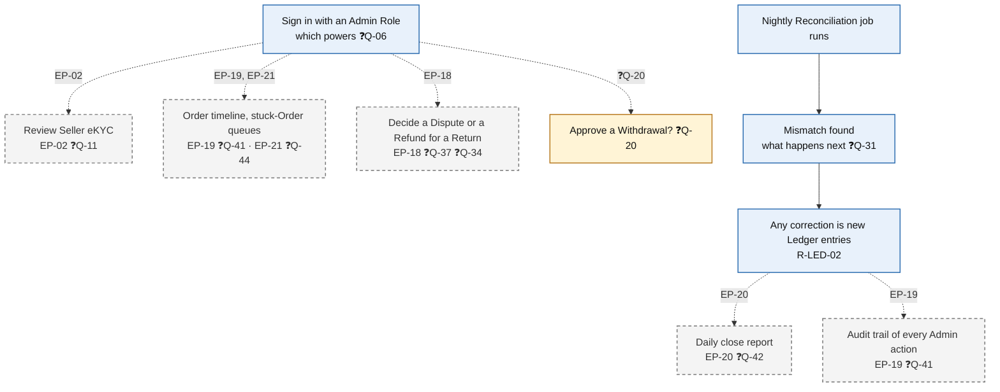

Only the Reconciliation path is Core; it is a nightly job, not something an Admin starts. Each dashed branch is a separate proposed epic. Whether an Admin approves Withdrawals is part of an open question.

❓ in this diagram: [Q-06](../OPEN_QUESTIONS.md#q-06) · [Q-11](../OPEN_QUESTIONS.md#q-11) · [Q-20](../OPEN_QUESTIONS.md#q-20) · [Q-31](../OPEN_QUESTIONS.md#q-31) · [Q-34](../OPEN_QUESTIONS.md#q-34) · [Q-37](../OPEN_QUESTIONS.md#q-37) · [Q-41](../OPEN_QUESTIONS.md#q-41) · [Q-42](../OPEN_QUESTIONS.md#q-42) · [Q-44](../OPEN_QUESTIONS.md#q-44)

**Decisions that affect Admins:** [Q-06](../OPEN_QUESTIONS.md#q-06) (Admin powers) · [Q-11](../OPEN_QUESTIONS.md#q-11) (when eKYC is required) · [Q-20](../OPEN_QUESTIONS.md#q-20) (Withdrawal approval) · [Q-31](../OPEN_QUESTIONS.md#q-31) (Reconciliation sources, Mismatch handling) · [Q-34](../OPEN_QUESTIONS.md#q-34) (who decides a Refund) · [Q-37](../OPEN_QUESTIONS.md#q-37) (after-sales cases) · [Q-41](../OPEN_QUESTIONS.md#q-41) (back-office, audit trail, fraud) · [Q-42](../OPEN_QUESTIONS.md#q-42) (finance reports) · [Q-44](../OPEN_QUESTIONS.md#q-44) (stuck-state detection)

Sources: [PROJECT_OVERVIEW: Users](../PROJECT_OVERVIEW.md#users), [EPICS](../product/EPICS.md), [GLOSSARY](../GLOSSARY.md), [identity.md](../domain/identity.md), [ledger.md](../domain/ledger.md), [reconciliation.md](../domain/reconciliation.md)

## 4. Core flows

Sequence diagrams use one shared legend: a **solid arrow** is a Core step; a **dotted arrow** is a proposed step and names its EP-xx; ❓Q-xx sits in the label or in a note on the exact step.

### 4.1 Checkout

Ordering runs the Checkout saga. Each step that can fail after an earlier step succeeded has a **Compensation** (a step that undoes the earlier one) ([R-ORD-02](../domain/ordering.md#r-ord-02)). The exact steps and their order are not decided ([Q-25](../OPEN_QUESTIONS.md#q-25)). The two diagrams below follow the step list that Q-25 proposes; it is a proposal, not a decision. Two more terms: an **Idempotency key** is a value the client sends in the `Idempotency-Key` header so that a repeated write has one effect, and a **Re-query** is asking a Payment gateway for a payment's status when the IPN is late or missing.

**4.1a Place the Order and reserve Stock**

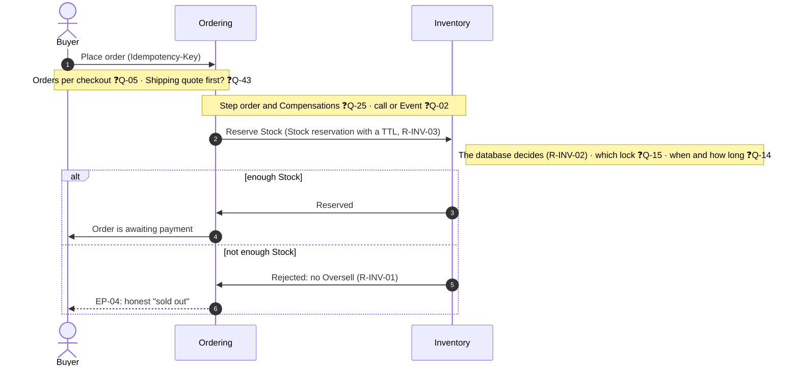

The database, not a cache or a rate limiter, stops overselling. A reservation has a **TTL** (a time limit): if it is not used in time, the Stock becomes sellable again.

❓ in this diagram: [Q-02](../OPEN_QUESTIONS.md#q-02) · [Q-05](../OPEN_QUESTIONS.md#q-05) · [Q-14](../OPEN_QUESTIONS.md#q-14) · [Q-15](../OPEN_QUESTIONS.md#q-15) · [Q-25](../OPEN_QUESTIONS.md#q-25) · [Q-43](../OPEN_QUESTIONS.md#q-43)

**4.1b Pay, use the reservation, publish the Event**

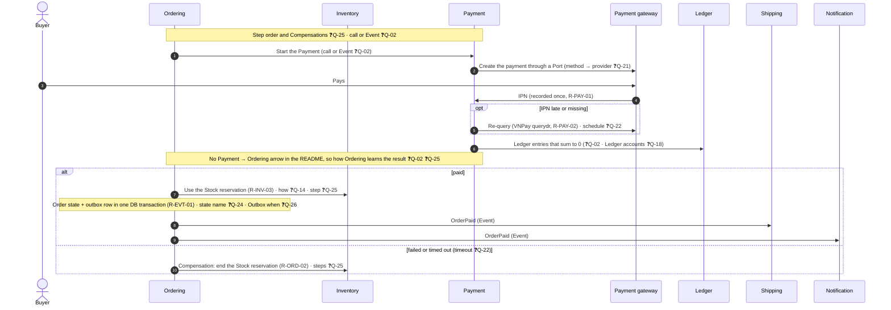

Gateways resend IPNs, so a repeat is recorded once. If the IPN is late, Payment uses a Re-query. A paid Order is published as `OrderPaid` through a **Transactional Outbox** (a table written in the same DB transaction as the change; a relay then publishes its Events).

❓ in this diagram: [Q-02](../OPEN_QUESTIONS.md#q-02) · [Q-14](../OPEN_QUESTIONS.md#q-14) · [Q-18](../OPEN_QUESTIONS.md#q-18) · [Q-21](../OPEN_QUESTIONS.md#q-21) · [Q-22](../OPEN_QUESTIONS.md#q-22) · [Q-24](../OPEN_QUESTIONS.md#q-24) · [Q-25](../OPEN_QUESTIONS.md#q-25) · [Q-26](../OPEN_QUESTIONS.md#q-26)

Not decided: a payment that succeeds after the reservation expired ([Q-14](../OPEN_QUESTIONS.md#q-14)); an IPN for an unknown or closed Order ([Q-25](../OPEN_QUESTIONS.md#q-25)).

Sources: [README: The problem](../../README.md#the-problem), [ordering.md](../domain/ordering.md), [inventory.md](../domain/inventory.md), [payment.md](../domain/payment.md), [RULES_AND_CONSTRAINTS: R-EVT-01](../RULES_AND_CONSTRAINTS.md#r-evt-01), [GLOSSARY](../GLOSSARY.md)

### 4.2 Money

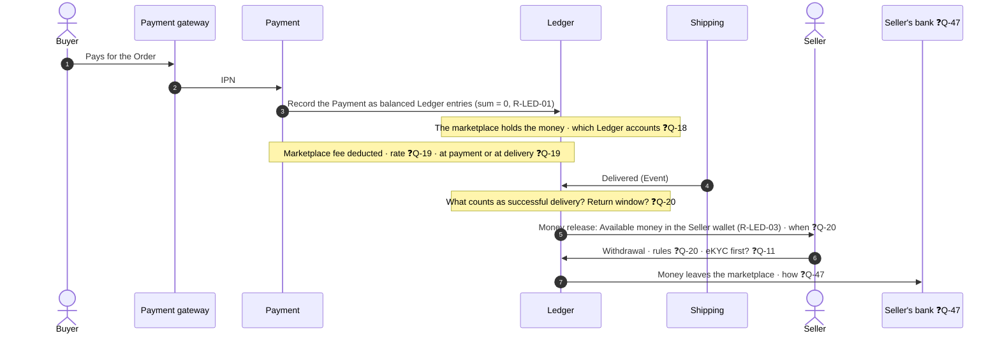

Every movement is written as Ledger entries on Ledger accounts, and all entries sum to 0. The Ledger is append-only: a wrong entry is fixed by new correcting entries ([R-LED-02](../domain/ledger.md#r-led-02)). **Money release** (making a Seller's money available) happens only after successful delivery; the result is **Available money** (money in a Seller wallet that the Seller may withdraw now). Every night, Reconciliation compares outside records with internal data ([R-REC-01](../domain/reconciliation.md#r-rec-01)); which sources it compares is open ([Q-31](../OPEN_QUESTIONS.md#q-31)).

❓ in this diagram: [Q-11](../OPEN_QUESTIONS.md#q-11) · [Q-18](../OPEN_QUESTIONS.md#q-18) · [Q-19](../OPEN_QUESTIONS.md#q-19) · [Q-20](../OPEN_QUESTIONS.md#q-20) · [Q-47](../OPEN_QUESTIONS.md#q-47)

Not decided: Refund flow and its Ledger entries ([Q-23](../OPEN_QUESTIONS.md#q-23)); a Refund after the Seller was paid ([Q-23](../OPEN_QUESTIONS.md#q-23)); COD, where the Carrier holds the money first ([Q-35](../OPEN_QUESTIONS.md#q-35), EP-22, Proposed).

Sources: [README: The problem](../../README.md#the-problem), [ledger.md](../domain/ledger.md), [reconciliation.md](../domain/reconciliation.md), [GLOSSARY: Money](../GLOSSARY.md#money), [ARCHITECTURE: External systems](../ARCHITECTURE.md#external-systems)

### 4.3 Shipment and successful delivery

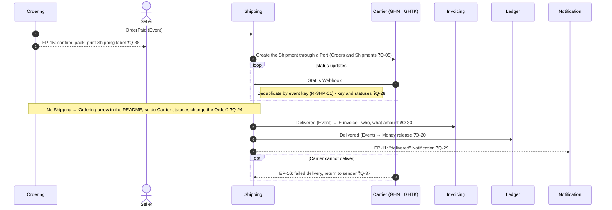

After `OrderPaid`, Shipping creates a Shipment. Carriers send status updates that can be duplicated or out of order, so Shipping removes repeats by an event key. Invoicing and Ledger react to `Delivered`. Whether `Delivered` alone makes the Seller's money available is not decided ([Q-20](../OPEN_QUESTIONS.md#q-20)).

❓ in this diagram: [Q-05](../OPEN_QUESTIONS.md#q-05) · [Q-20](../OPEN_QUESTIONS.md#q-20) · [Q-24](../OPEN_QUESTIONS.md#q-24) · [Q-28](../OPEN_QUESTIONS.md#q-28) · [Q-29](../OPEN_QUESTIONS.md#q-29) · [Q-30](../OPEN_QUESTIONS.md#q-30) · [Q-37](../OPEN_QUESTIONS.md#q-37) · [Q-38](../OPEN_QUESTIONS.md#q-38)

Not decided: `Delivered` arriving twice at Invoicing or Ledger ([Q-27](../OPEN_QUESTIONS.md#q-27)).

Sources: [README: Architecture](../../README.md#architecture), [shipping.md](../domain/shipping.md), [invoicing.md](../domain/invoicing.md), [notification.md](../domain/notification.md), [ledger.md](../domain/ledger.md), [EPICS: EP-15](../product/EPICS.md#ep-15), [EP-16](../product/EPICS.md#ep-16), [EP-11](../product/EPICS.md#ep-11)

### 4.4 Failure cases

The README lists six hard situations. This table maps each to where the tour shows it.

| Situation (README) | Protection (README) | Rule | Shown in |
|---|---|---|---|
| 1,000 people buy a Product with 10 left | DB-level locking, Stock reservations with a TTL, per-user rate limit | [R-INV-01](../domain/inventory.md#r-inv-01)…[R-INV-04](../domain/inventory.md#r-inv-04) | [4.1a](#s4-checkout) (R-INV-01 to R-INV-03; the rate limit is not drawn) |
| "Place order" clicked twice | `Idempotency-Key` on every write API | [R-API-01](../RULES_AND_CONSTRAINTS.md#r-api-01), [R-ORD-03](../domain/ordering.md#r-ord-03) | [Double click](#f-double-click) |
| IPN sent 10 times, or never | Idempotent IPN handling, Re-query, saga with Compensation | [R-PAY-01](../domain/payment.md#r-pay-01), [R-PAY-02](../domain/payment.md#r-pay-02), [R-ORD-02](../domain/ordering.md#r-ord-02) | [IPN](#f-ipn) |
| DB write succeeds, publishing the Event fails | Transactional Outbox | [R-EVT-01](../RULES_AND_CONSTRAINTS.md#r-evt-01) | [Event publish](#f-outbox) |
| Money does not match the bank | Double-entry Ledger, nightly Reconciliation | [R-LED-01](../domain/ledger.md#r-led-01), [R-REC-01](../domain/reconciliation.md#r-rec-01) | [4.2](#s4-money) |
| Carrier status duplicated or out of order | State machine blocks invalid transitions; deduplication by event key | [R-ORD-01](../domain/ordering.md#r-ord-01), [R-SHP-01](../domain/shipping.md#r-shp-01) | [Carrier status](#f-carrier) |

**Double click on "Place order"**

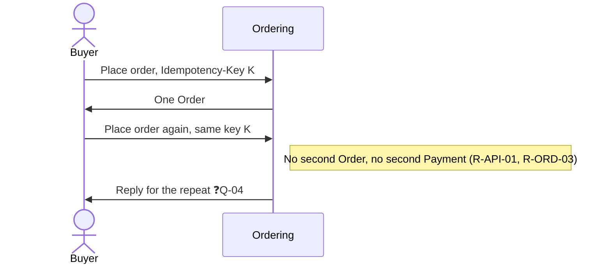

The repeat carries the same Idempotency key, so it has one effect. What the second reply contains, and how keys are stored, is open.

❓ in this diagram: [Q-04](../OPEN_QUESTIONS.md#q-04)

**Duplicate or missing IPN**

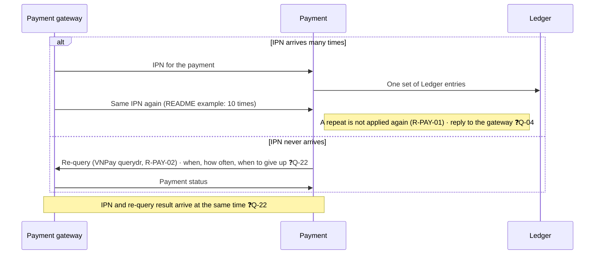

The README target is "IPN sent 10 times → recorded once". An Order must not stay "awaiting payment" forever because one Webhook was lost.

❓ in this diagram: [Q-04](../OPEN_QUESTIONS.md#q-04) · [Q-22](../OPEN_QUESTIONS.md#q-22)

**Event publish failure**

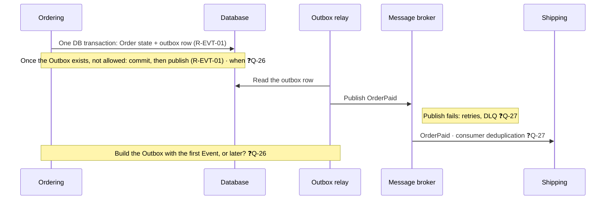

The Transactional Outbox stops the README's failure case: an Order is paid, but nobody ships it.

❓ in this diagram: [Q-26](../OPEN_QUESTIONS.md#q-26) · [Q-27](../OPEN_QUESTIONS.md#q-27)

**Out-of-order or duplicate Carrier status**

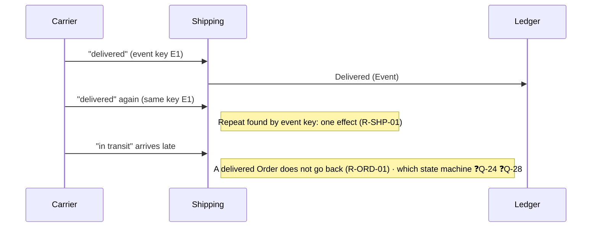

A duplicate "delivered" must not pay the Seller twice. A late "in transit" must not move a delivered Order back.

❓ in this diagram: [Q-24](../OPEN_QUESTIONS.md#q-24) · [Q-28](../OPEN_QUESTIONS.md#q-28)

Sources: [README: The problem](../../README.md#the-problem), [README: Metrics](../../README.md#metrics), [RULES_AND_CONSTRAINTS](../RULES_AND_CONSTRAINTS.md), [ordering.md](../domain/ordering.md), [payment.md](../domain/payment.md), [shipping.md](../domain/shipping.md), [GLOSSARY: Technical terms](../GLOSSARY.md#technical-terms)

## 5. Order state machine

The Order state machine rejects an invalid move ([R-ORD-01](../domain/ordering.md#r-ord-01)). The README names only three states: "awaiting payment", "in transit" and "delivered". Everything else is open ([Q-24](../OPEN_QUESTIONS.md#q-24)).

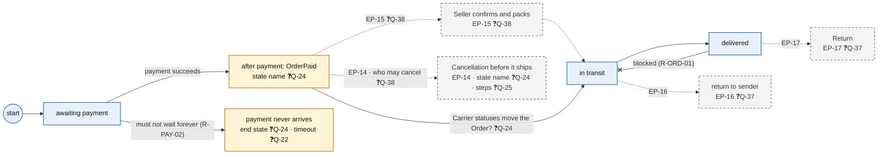

Solid boxes are the three states the README names. Amber boxes are steps the sources describe but whose state is not named. `Delivered` is also the name of the Shipping Event; if the Order keeps a state with the same name, the GLOSSARY must tell them apart ([Q-24](../OPEN_QUESTIONS.md#q-24)).

❓ in this diagram: [Q-22](../OPEN_QUESTIONS.md#q-22) · [Q-24](../OPEN_QUESTIONS.md#q-24) · [Q-25](../OPEN_QUESTIONS.md#q-25) · [Q-37](../OPEN_QUESTIONS.md#q-37) · [Q-38](../OPEN_QUESTIONS.md#q-38)

Sources: [README: The problem](../../README.md#the-problem), [ordering.md](../domain/ordering.md), [payment.md](../domain/payment.md), [GLOSSARY: Orders and payment](../GLOSSARY.md#orders-and-payment), [OPEN_QUESTIONS: Q-24](../OPEN_QUESTIONS.md#q-24), [EPICS](../product/EPICS.md)

## 6. Feature catalogue

Status: **Core** = the epic's Scope is "README"; **Proposed** = the epic's Scope is "new scope proposal". Every epic's Decision is still `_pending_`, so details that a Core epic adds beyond the README are proposals too. Priorities are recommendations, not decisions. "For whom" is the epic's "Benefits" line (STR = the business strategist's view).

| Epic | For whom | Context | Priority | Status | Q-IDs |
|---|---|---|---|---|---|
| [EP-01](../product/EPICS.md#ep-01) Accounts and roles | all users | Identity | Must | Core | [Q-06](../OPEN_QUESTIONS.md#q-06) |
| [EP-02](../product/EPICS.md#ep-02) Seller onboarding and eKYC | Admin, Buyer | Identity | Must | Core | [Q-11](../OPEN_QUESTIONS.md#q-11) |
| [EP-03](../product/EPICS.md#ep-03) Product catalog | Seller, Buyer | Catalog | Must | Core | [Q-09](../OPEN_QUESTIONS.md#q-09), [Q-12](../OPEN_QUESTIONS.md#q-12), [Q-13](../OPEN_QUESTIONS.md#q-13) |
| [EP-04](../product/EPICS.md#ep-04) Stock and stock reservations | Buyer, Seller | Inventory | Must | Core | [Q-09](../OPEN_QUESTIONS.md#q-09), [Q-14](../OPEN_QUESTIONS.md#q-14), [Q-15](../OPEN_QUESTIONS.md#q-15) |
| [EP-05](../product/EPICS.md#ep-05) Flash sale | Buyer, Seller | Inventory | Must | Core | [Q-16](../OPEN_QUESTIONS.md#q-16), [Q-17](../OPEN_QUESTIONS.md#q-17) |
| [EP-06](../product/EPICS.md#ep-06) Checkout and order placement | Buyer | Ordering | Must | Core | [Q-05](../OPEN_QUESTIONS.md#q-05), [Q-09](../OPEN_QUESTIONS.md#q-09), [Q-24](../OPEN_QUESTIONS.md#q-24), [Q-25](../OPEN_QUESTIONS.md#q-25), [Q-43](../OPEN_QUESTIONS.md#q-43) |
| [EP-07](../product/EPICS.md#ep-07) Online payment | Buyer, Admin | Payment | Must | Core | [Q-09](../OPEN_QUESTIONS.md#q-09), [Q-21](../OPEN_QUESTIONS.md#q-21), [Q-22](../OPEN_QUESTIONS.md#q-22) |
| [EP-08](../product/EPICS.md#ep-08) Ledger, Seller wallet and Marketplace fee | Seller, Admin, STR | Ledger | Must | Core | [Q-18](../OPEN_QUESTIONS.md#q-18), [Q-19](../OPEN_QUESTIONS.md#q-19) |
| [EP-09](../product/EPICS.md#ep-09) Withdrawal | Seller, Admin | Ledger | Must | Core | [Q-20](../OPEN_QUESTIONS.md#q-20), [Q-47](../OPEN_QUESTIONS.md#q-47) |
| [EP-10](../product/EPICS.md#ep-10) Shipping and tracking | Buyer, Seller | Shipping | Must | Core | [Q-20](../OPEN_QUESTIONS.md#q-20), [Q-28](../OPEN_QUESTIONS.md#q-28), [Q-43](../OPEN_QUESTIONS.md#q-43) |
| [EP-11](../product/EPICS.md#ep-11) Notifications for Buyers and Sellers | Buyer, Seller | Notification | Should | Core | [Q-29](../OPEN_QUESTIONS.md#q-29), [Q-37](../OPEN_QUESTIONS.md#q-37) |
| [EP-12](../product/EPICS.md#ep-12) E-invoices | Admin, Seller, Buyer | Invoicing | Must | Core | [Q-30](../OPEN_QUESTIONS.md#q-30), [Q-37](../OPEN_QUESTIONS.md#q-37) |
| [EP-13](../product/EPICS.md#ep-13) Reconciliation | Admin, STR | Reconciliation | Must | Core | [Q-09](../OPEN_QUESTIONS.md#q-09), [Q-31](../OPEN_QUESTIONS.md#q-31) |
| [EP-14](../product/EPICS.md#ep-14) Cancellation and Refund before shipment | Buyer, Seller | Ordering, Payment, Inventory, Ledger | Must | Core | [Q-23](../OPEN_QUESTIONS.md#q-23), [Q-25](../OPEN_QUESTIONS.md#q-25), [Q-38](../OPEN_QUESTIONS.md#q-38) |
| [EP-15](../product/EPICS.md#ep-15) Seller order handling | Seller | Ordering, Shipping | Must | Proposed | [Q-38](../OPEN_QUESTIONS.md#q-38) |
| [EP-16](../product/EPICS.md#ep-16) Failed delivery and return to sender | Seller, Admin | Shipping, Inventory, Ledger | Must | Proposed | [Q-37](../OPEN_QUESTIONS.md#q-37) |
| [EP-17](../product/EPICS.md#ep-17) Return and Refund after delivery | Buyer, Seller | none yet | Must | Proposed | [Q-34](../OPEN_QUESTIONS.md#q-34), [Q-37](../OPEN_QUESTIONS.md#q-37) |
| [EP-18](../product/EPICS.md#ep-18) Disputes and Wallet hold | Buyer, Seller, Admin | none yet, Ledger | Should | Proposed | [Q-20](../OPEN_QUESTIONS.md#q-20), [Q-34](../OPEN_QUESTIONS.md#q-34), [Q-37](../OPEN_QUESTIONS.md#q-37) |
| [EP-19](../product/EPICS.md#ep-19) Admin back-office and audit trail | Admin | all (cross-cutting) | Must | Proposed | [Q-06](../OPEN_QUESTIONS.md#q-06), [Q-41](../OPEN_QUESTIONS.md#q-41) |
| [EP-20](../product/EPICS.md#ep-20) Seller statement and reports | Seller, Admin | Ledger | Must | Proposed | [Q-42](../OPEN_QUESTIONS.md#q-42) |
| [EP-21](../product/EPICS.md#ep-21) Stuck-state detection and monitoring | Admin, Seller | all (cross-cutting) | Should | Proposed | [Q-44](../OPEN_QUESTIONS.md#q-44) |
| [EP-22](../product/EPICS.md#ep-22) Cash on delivery (COD) | Buyer | Payment, Ledger, Reconciliation, Shipping | Should | Proposed | [Q-35](../OPEN_QUESTIONS.md#q-35) |
| [EP-23](../product/EPICS.md#ep-23) Seller tax withholding | Admin, Seller | Ledger, Invoicing | Should | Proposed | [Q-39](../OPEN_QUESTIONS.md#q-39) |
| [EP-24](../product/EPICS.md#ep-24) Personal data protection and retention | Buyer, Admin | Identity, all | Must | Proposed | [Q-39](../OPEN_QUESTIONS.md#q-39) |
| [EP-25](../product/EPICS.md#ep-25) Trust signals: reviews and ratings | Buyer | none yet | Should | Proposed | [Q-36](../OPEN_QUESTIONS.md#q-36) |
| [EP-26](../product/EPICS.md#ep-26) Fraud signals and Seller penalties | Admin | Identity, all | Could | Proposed | [Q-41](../OPEN_QUESTIONS.md#q-41) |
| [EP-27](../product/EPICS.md#ep-27) Bulk product import | Seller | Catalog, Inventory | Should | Proposed | [Q-40](../OPEN_QUESTIONS.md#q-40) |
| [EP-28](../product/EPICS.md#ep-28) Multi-channel stock sync | Seller | Inventory | Could | Proposed | [Q-15](../OPEN_QUESTIONS.md#q-15), [Q-40](../OPEN_QUESTIONS.md#q-40) |
| [EP-29](../product/EPICS.md#ep-29) Vouchers | Buyer, Seller | Ordering, Ledger | Could | Proposed | [Q-36](../OPEN_QUESTIONS.md#q-36) |
| [EP-30](../product/EPICS.md#ep-30) Seller subscriptions and sponsored placement | STR, Seller | Ledger, Catalog | Could | Proposed | [Q-36](../OPEN_QUESTIONS.md#q-36) |
| [EP-31](../product/EPICS.md#ep-31) Buyer–Seller chat and livestream selling | Buyer, Seller | none yet | Won't (this time) | Proposed (chat is a README extension track) | [Q-36](../OPEN_QUESTIONS.md#q-36) |

Sources: [EPICS: Summary](../product/EPICS.md#summary), [EPICS: Epics](../product/EPICS.md#epics), [README: Roadmap](../../README.md#roadmap)

## 7. Decisions waiting for you

Every Q-ID that appears in this file. ★ = must be answered before the first module is built. Options and analysis live only in [OPEN_QUESTIONS](../OPEN_QUESTIONS.md).

| Q-ID | ★ | Question | Where it appears | Details |
|---|---|---|---|---|
| Q-02 | ★ | How contexts call each other | [2](#s2) · [4.1 Checkout](#s4-checkout) | [details](../OPEN_QUESTIONS.md#q-02) |
| Q-04 | ★ | `Idempotency-Key` behavior and storage | [4.4 Failure](#s4-failures) | [details](../OPEN_QUESTIONS.md#q-04) |
| Q-05 | ★ | Can one order hold products from several sellers? | [3.1 Buyer](#s3-buyer) · [4.1 Checkout](#s4-checkout) · [4.3 Shipment](#s4-shipment) · [6](#s6) | [details](../OPEN_QUESTIONS.md#q-05) |
| Q-06 | ★ | Roles, token lifetime, admin powers | [1](#s1) · [2](#s2) · [3.1 Buyer](#s3-buyer) · [3.2 Seller](#s3-seller) · [3.3 Admin](#s3-admin) · [6](#s6) | [details](../OPEN_QUESTIONS.md#q-06) |
| Q-09 | ★ | Approve the build order; which module is first | [6](#s6) | [details](../OPEN_QUESTIONS.md#q-09) |
| Q-11 |  | Seller eKYC: required before what? | [3.2 Seller](#s3-seller) · [3.3 Admin](#s3-admin) · [4.2 Money](#s4-money) · [6](#s6) | [details](../OPEN_QUESTIONS.md#q-11) |
| Q-12 |  | Currency and money storage | [3.1 Buyer](#s3-buyer) · [3.2 Seller](#s3-seller) · [6](#s6) | [details](../OPEN_QUESTIONS.md#q-12) |
| Q-13 |  | What is a variant; where do price and stock live? | [3.1 Buyer](#s3-buyer) · [3.2 Seller](#s3-seller) · [6](#s6) | [details](../OPEN_QUESTIONS.md#q-13) |
| Q-14 |  | Stock reservation lifecycle and TTL | [3.1 Buyer](#s3-buyer) · [4.1 Checkout](#s4-checkout) · [6](#s6) | [details](../OPEN_QUESTIONS.md#q-14) |
| Q-15 |  | DB-level locking strategy for stock | [3.2 Seller](#s3-seller) · [4.1 Checkout](#s4-checkout) · [6](#s6) | [details](../OPEN_QUESTIONS.md#q-15) |
| Q-16 |  | Per-user rate limit values and algorithm | [3.1 Buyer](#s3-buyer) · [6](#s6) | [details](../OPEN_QUESTIONS.md#q-16) |
| Q-17 |  | What exactly is a flash sale? | [3.1 Buyer](#s3-buyer) · [3.2 Seller](#s3-seller) · [6](#s6) | [details](../OPEN_QUESTIONS.md#q-17) |
| Q-18 |  | Ledger accounts | [3.2 Seller](#s3-seller) · [3.3 Admin](#s3-admin) · [4.1 Checkout](#s4-checkout) · [4.2 Money](#s4-money) · [6](#s6) | [details](../OPEN_QUESTIONS.md#q-18) |
| Q-19 |  | Marketplace fee rate and timing | [3.2 Seller](#s3-seller) · [4.2 Money](#s4-money) · [6](#s6) | [details](../OPEN_QUESTIONS.md#q-19) |
| Q-20 |  | Successful delivery, return window, withdrawal rules | [3.1 Buyer](#s3-buyer) · [3.2 Seller](#s3-seller) · [3.3 Admin](#s3-admin) · [4.2 Money](#s4-money) · [4.3 Shipment](#s4-shipment) · [6](#s6) | [details](../OPEN_QUESTIONS.md#q-20) |
| Q-21 |  | Payment method → provider mapping | [3.1 Buyer](#s3-buyer) · [4.1 Checkout](#s4-checkout) · [6](#s6) | [details](../OPEN_QUESTIONS.md#q-21) |
| Q-22 |  | Re-query schedule and payment timeout | [3.1 Buyer](#s3-buyer) · [4.1 Checkout](#s4-checkout) · [4.4 Failure](#s4-failures) · [5](#s5) · [6](#s6) | [details](../OPEN_QUESTIONS.md#q-22) |
| Q-23 |  | Refund flow and ledger entries | [3.1 Buyer](#s3-buyer) · [4.2 Money](#s4-money) · [6](#s6) | [details](../OPEN_QUESTIONS.md#q-23) |
| Q-24 |  | Order states and transitions | [4.1 Checkout](#s4-checkout) · [4.3 Shipment](#s4-shipment) · [4.4 Failure](#s4-failures) · [5](#s5) · [6](#s6) | [details](../OPEN_QUESTIONS.md#q-24) |
| Q-25 |  | Checkout saga steps and compensation | [3.1 Buyer](#s3-buyer) · [4.1 Checkout](#s4-checkout) · [5](#s5) · [6](#s6) | [details](../OPEN_QUESTIONS.md#q-25) |
| Q-26 |  | Outbox with the first event, or later? | [4.1 Checkout](#s4-checkout) · [4.4 Failure](#s4-failures) | [details](../OPEN_QUESTIONS.md#q-26) |
| Q-27 |  | Retries, DLQ, consumer deduplication | [4.3 Shipment](#s4-shipment) · [4.4 Failure](#s4-failures) | [details](../OPEN_QUESTIONS.md#q-27) |
| Q-28 |  | Shipment event key and state machine | [3.1 Buyer](#s3-buyer) · [3.2 Seller](#s3-seller) · [4.3 Shipment](#s4-shipment) · [4.4 Failure](#s4-failures) · [6](#s6) | [details](../OPEN_QUESTIONS.md#q-28) |
| Q-29 |  | Which events notify whom, on which channel | [3.1 Buyer](#s3-buyer) · [3.2 Seller](#s3-seller) · [4.3 Shipment](#s4-shipment) · [6](#s6) | [details](../OPEN_QUESTIONS.md#q-29) |
| Q-30 |  | Who issues e-invoices, for what, and when | [3.1 Buyer](#s3-buyer) · [3.3 Admin](#s3-admin) · [4.3 Shipment](#s4-shipment) · [6](#s6) | [details](../OPEN_QUESTIONS.md#q-30) |
| Q-31 |  | Reconciliation sources and mismatch handling | [2](#s2) · [3.3 Admin](#s3-admin) · [4.2 Money](#s4-money) · [6](#s6) | [details](../OPEN_QUESTIONS.md#q-31) |
| Q-34 |  | Who decides a Refund for a Return, and how fast? | [3.1 Buyer](#s3-buyer) · [3.3 Admin](#s3-admin) · [6](#s6) | [details](../OPEN_QUESTIONS.md#q-34) |
| Q-35 |  | Is cash on delivery (COD) in scope? | [3.1 Buyer](#s3-buyer) · [4.2 Money](#s4-money) · [6](#s6) | [details](../OPEN_QUESTIONS.md#q-35) |
| Q-36 |  | Engagement and revenue features: in, later, or out? | [3.1 Buyer](#s3-buyer) · [3.2 Seller](#s3-seller) · [6](#s6) | [details](../OPEN_QUESTIONS.md#q-36) |
| Q-37 |  | After-sales exceptions: in scope, and which context owns them? | [3.1 Buyer](#s3-buyer) · [3.2 Seller](#s3-seller) · [3.3 Admin](#s3-admin) · [4.3 Shipment](#s4-shipment) · [5](#s5) · [6](#s6) | [details](../OPEN_QUESTIONS.md#q-37) |
| Q-38 |  | Is there a Seller handling step between payment and Shipment? | [3.1 Buyer](#s3-buyer) · [3.2 Seller](#s3-seller) · [4.3 Shipment](#s4-shipment) · [5](#s5) · [6](#s6) | [details](../OPEN_QUESTIONS.md#q-38) |
| Q-39 |  | Vietnam compliance scope: Seller tax withholding, personal data | [3.1 Buyer](#s3-buyer) · [3.2 Seller](#s3-seller) · [3.3 Admin](#s3-admin) · [6](#s6) | [details](../OPEN_QUESTIONS.md#q-39) |
| Q-40 |  | Bulk product import and multi-channel stock sync: in scope? | [3.2 Seller](#s3-seller) · [6](#s6) | [details](../OPEN_QUESTIONS.md#q-40) |
| Q-41 |  | Admin back-office, audit trail and fraud tools: scope and home | [3.3 Admin](#s3-admin) · [6](#s6) | [details](../OPEN_QUESTIONS.md#q-41) |
| Q-42 |  | Reporting: Seller statement, Seller reports, finance reports | [3.2 Seller](#s3-seller) · [3.3 Admin](#s3-admin) · [6](#s6) | [details](../OPEN_QUESTIONS.md#q-42) |
| Q-43 |  | Does checkout need a Shipping quote before payment? | [3.1 Buyer](#s3-buyer) · [4.1 Checkout](#s4-checkout) · [6](#s6) | [details](../OPEN_QUESTIONS.md#q-43) |
| Q-44 |  | Stuck-state detection: in scope, and where does it live? | [3.3 Admin](#s3-admin) · [6](#s6) | [details](../OPEN_QUESTIONS.md#q-44) |
| Q-47 |  | How does a Withdrawal move money to the Seller's bank? | [3.2 Seller](#s3-seller) · [4.2 Money](#s4-money) · [6](#s6) | [details](../OPEN_QUESTIONS.md#q-47) |

Sources: [OPEN_QUESTIONS: Summary](../OPEN_QUESTIONS.md#summary)
